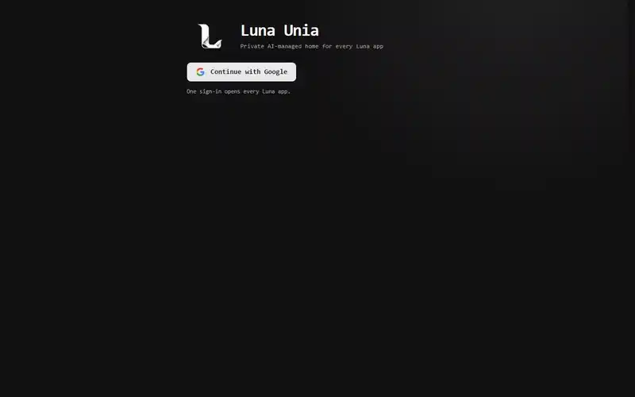
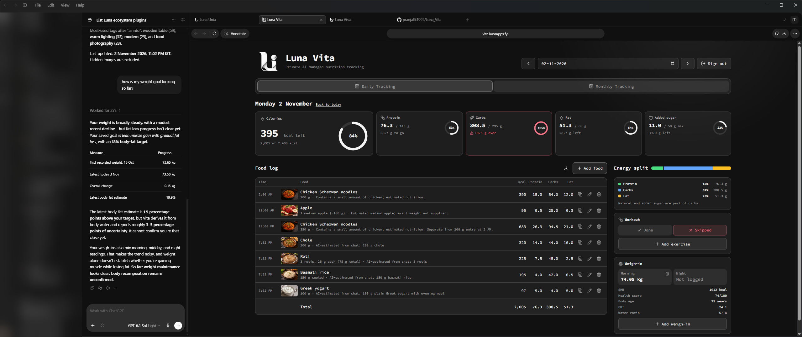

# Luna Vita


**Track food, water, workouts, body measurements and lab reports by chatting with your AI assistant.**
Tell it what you ate; it works out the calories and macros and logs them in Vita. Vita shows your day, your month,
and how your lab results change over time.

<p align="center">
  <a href="docs/assets/luna-vita-showcase.mp4"></a>
</p>

<p align="center"><em>Daily and monthly tracking, the Health Reports tab (sample reports with fictional data), then an
assistant logging a meal. Select it for the sharper video.</em></p>

## What it does

- **Daily log:** each food with its time, photo, calories, protein, carbs, fat and sugar, against your daily targets.
- **Monthly tracking:** daily averages, a chart per nutrient, foods to prefer or avoid, and a workout calendar.
- **Body, water and workouts:** morning and night weigh-ins with body fat, a water goal, and each day's exercises.
- **Health reports:** your lab reports, read by Luna Lexia, with each result against its printed range, trends across
  reports, and the PDF a click away.
- **Food photos:** every food shows a picture; add your own with **+**, or let your assistant generate one.
- **Daily PDF** of the day's food, activity and measurements.

The assistant does the estimating ("4 parathas of 40 g") and calls Vita's tools, so Vita needs no AI key of its own.

<p align="center">
  
</p>

## Quickstart

Vita runs on [Luna Sentia](https://github.com/pranjallk1995/Luna_Sentia), which provides its database and sign-in.
On one machine you need no `.env`:

```sh
git clone https://github.com/pranjallk1995/Luna_Sentia.git
git clone https://github.com/pranjallk1995/Luna_Vita.git
./Luna_Sentia/luna.sh start vita
```

Open <http://localhost:18506> and sign in as Sentia's owner. Before giving Vita a public address, set your own secrets:
see [Getting started](https://github.com/pranjallk1995/Luna_Vita/wiki/Getting-Started).

## Connect your AI assistant

Add `https://<your vita MCP host>/mcp` to Claude, ChatGPT or any MCP client as a custom connector (OAuth). You sign in
with your Luna account, and the tools act only on your data. Every tool is listed in
[MCP tools](https://github.com/pranjallk1995/Luna_Vita/wiki/MCP-Tools).

## Works with

- **[Luna Visia](https://github.com/pranjallk1995/Luna_Visia)** stores the food photos.
- **[Luna Lexia](https://github.com/pranjallk1995/Luna_Lexia)** reads and stores the lab reports Vita shows.

Without them Vita still runs; food shows a placeholder and the Health Reports tab says it cannot reach Lexia.

## Documentation

The [wiki](https://github.com/pranjallk1995/Luna_Vita/wiki) has the full reference:

| Page | What's in it |
| --- | --- |
| [Home](https://github.com/pranjallk1995/Luna_Vita/wiki) | Every feature in detail |
| [Getting started](https://github.com/pranjallk1995/Luna_Vita/wiki/Getting-Started) | Setup, `.env`, sign-in |
| [MCP tools](https://github.com/pranjallk1995/Luna_Vita/wiki/MCP-Tools) | Every tool your assistant can call |
| [Architecture](https://github.com/pranjallk1995/Luna_Vita/wiki/Architecture) | Services, users and storage, data model, database diagram |
| [Development](https://github.com/pranjallk1995/Luna_Vita/wiki/Development) | Project structure, modules, tests |
| [Operations](https://github.com/pranjallk1995/Luna_Vita/wiki/Operations) | The database UI |

The UI follows [UI_STYLE_GUIDE.md](UI_STYLE_GUIDE.md).

## Releases and development

Releases are on the [Releases page](https://github.com/pranjallk1995/Luna_Vita/releases). To update: `git pull`, then
`./Luna_Sentia/luna.sh start vita`. To run your local code and reload it as you edit:
`./Luna_Sentia/luna.sh start --build --watch vita`.
