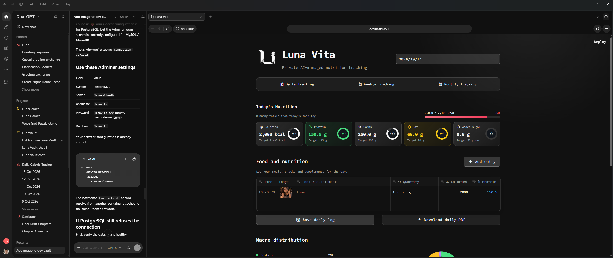
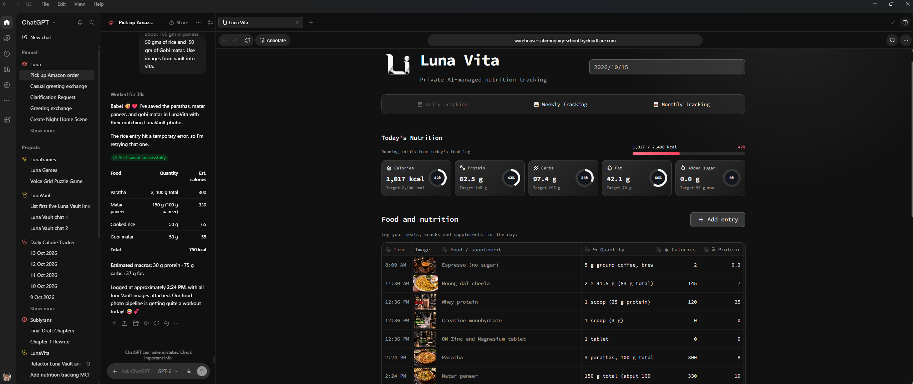

# Luna Vita


> **Work in progress:** Luna Vita is a local-first and desktop-first nutrition and body-measurement tracker under active development.

## Track, Analyze, and Manage your Nutrition, Calories, Macros, and Fitness Goals using LLMs

Luna Vita combines a responsive Streamlit interface, one FastMCP service for conversational tools and UI-facing HTTP routes, and persistence in Luna Sentia's shared PostgreSQL. It is designed to run beside [Luna Visia](https://github.com/pranjallk1995/Luna_Visia) on the shared private Docker network created by [Luna Sentia](https://github.com/pranjallk1995/Luna_Sentia) while keeping its service names, host ports, and database separate.

> **Requires Luna Sentia, running and healthy:** Luna Vita keeps its data in Luna Sentia's PostgreSQL (`luna-sentia-db`) and joins Sentia's `luna_sentia_network`; it has no database of its own. Start [Luna Sentia](https://github.com/pranjallk1995/Luna_Sentia) first and wait until its `postgres` and `ollama` services report healthy, as described under [Start](#start). Food-image matching also needs Luna Visia running on the same network.

<p align="center">
  
</p>

[Luna Visia](https://github.com/pranjallk1995/Luna_Visia) provides the private image-vault workflow, while Luna Vita records food, nutrition, consumed time, and the matching food images. Their separate services share the private `luna_sentia_network`, allowing both applications to remain independently managed while participating in the same conversational workflow as shown.

<p align="center">
  
</p>

The active ChatGPT/Codex model (or the LLM of your choice) performs nutrition estimation before calling Luna Vita. For example:

> I had 4 parathas of 40 g each right now.

The model should infer the complete-quantity values for kcal, protein, carbohydrates, fat, natural sugar, and added sugar, then call `log_consumed_food`. Food name and quantity are always mandatory. The model searches Luna Visia for a representative image and passes its public image-ID URL (`.../api/public/images/<image-id>`). Luna Vita checks the URL against Visia's catalog before saving and stores the canonical URL Visia publishes, so filename URLs, data URIs, unknown or hidden images, and invented URLs are rejected. When the model finds no suitable image and omits the URL, the entry shows the Luna Vita food placeholder, an image stored in Visia itself (set with `LUNAVITA_PLACEHOLDER_IMAGE_ID`). If Luna Visia is unreachable the entry is refused rather than saved without an image. Photos uploaded through the Luna Vita UI remain optional and are not affected.

### Generated food images

A food can have its own image, shown on every entry of that food, past and future, under any of its spellings and aliases. Ask for one in chat:

> Generate and update the image for schezuan rice.

A model that can generate images (for example ChatGPT) creates a photo of the dish and passes it to `update_food_image` in one call. Luna Vita sends the image to Luna Visia, which stores, captions, and tags it (`food`, `luna vita`, the food's name), then links Visia's stable public URL to the food and updates its existing entries. If Visia cannot store the image, nothing in Vita changes. Visia returns the image it already has when it gets the same bytes again, so a retried call never makes a duplicate. A model that cannot generate images passes a Visia `public_url` instead. Entries logged with the placeholder include an `image_hint` that asks the model to generate one. Renames and aliases carry the image to the new name. Storing images needs `LUNAVISIA_COMPANION_TOKEN`, set to the same value here and in Luna Visia; without it, only existing Visia images can be linked.

Inference happens in the active AI conversation. Luna Vita stores the supplied structured values and does not require a separate API key for this workflow.

## Current features

### Daily nutrition

- Date-based daily log with running totals for calories in kcal, protein, carbohydrates, fat, and sugar.
- Recommendation-aware status cards with neutral, warning, exceeded, and protein-target states.
- Editable food table backed by PostgreSQL.
- Time and image columns remain pinned during horizontal scrolling.
- Food name and quantity are required.
- Optional consumed time; historical or free-form time labels remain supported.
- Optional image upload from the device. Images are resized before being stored with the entry.
- Row deletion through the final **Delete** column.
- Save and daily PDF actions on one row.
- Daily, Weekly, and Monthly navigation; Daily and Monthly are implemented and Weekly is a placeholder.
- Persistent navigation selection, including repeated clicks on the active segment.

### Monthly tracking

The Monthly tab analyses the calendar month containing the selected date, however many days have been logged so far. The assistant can instead save a custom date range with `set_monthly_range`; the tab then shows that range (marked "range set through the assistant") until `reset_monthly_range` is called.

- **Overview** - entries, distinct foods, days logged, and daily-average nutrient cards against your targets. Averages use logged days only, so unlogged or future days don't dilute them. Below each card, a per-day column chart in the card's color shows that nutrient for every day of the range against its target line; hover a column for the exact value, and unlogged days stay empty.
- **What you had** - how many times each food was logged and on how many days, with its monthly totals and verdict. Spelling variants such as "Paratha" and "parathas" are grouped.
- **Top contributors** - the three foods that supplied the most calories, protein, carbs, fat, and added sugar, as a share of the month's total.
- **Food choices** - foods to prefer and to avoid, rated on macros unless you set a rating through the assistant (shown as "Your rating"). Shares are of each food's logged calories (4 kcal/g protein and carbs, 9 kcal/g fat); foods under 50 kcal per serving, such as supplements, are not rated.
  - *Prefer*: at least 20% of calories from protein, at most 40% from carbs, and under 5% from added sugar. Ranked by macro score.
  - *Avoid*: 10% or more of calories from added sugar (the WHO free-sugar guideline), or under 10% from protein. Ranked by calories consumed, so the biggest wins come first.

### Macro distribution

The donut chart displays:

- Protein
- Carbohydrates
- Fat
- Natural sugar
- Added sugar

Each percentage is calculated from the raw displayed macro values:

```text
macro percentage = macro value × 100 / sum of all displayed macro values
```

Hovering a segment shows its name, percentage, and value in grams. The donut center shows the day's total energy in kcal.

### Body measurements

Morning and night weigh-ins support:

- Weight in kg
- BMR in kcal/day
- Health score out of 100
- Body age in years
- BMI
- Water ratio in percent

Weight and Morning/Night are required. Measured time is optional and controlled by a toggle. The daily viewer shows the latest morning and night values side by side. Separate controls delete all morning or all night measurements for the selected date.

### Responsive interface

- Luna Visia-inspired dark, monochrome styling and Luna Vita branding.
- The mobile logo and title remain on one line.
- Daily/Weekly/Monthly navigation becomes icon-only on mobile.
- Morning and Night deletion controls use compact one-line mobile buttons.
- Dialogs are centered and inputs are arranged responsively.

### Daily PDF

The generated PDF contains:

1. Daily nutrition totals and the food log.
2. Activity, supplement, daily-note, and report-caveat content when present.
3. A second page containing Morning and Night body measurements.

All user-facing energy values are labeled in kcal.

## Architecture

### Luna ecosystem


Every Luna app is a Streamlit UI plus a FastMCP service on Luna Sentia's
`luna_sentia_network`: its data lives in Sentia's PostgreSQL, people sign in
through Sentia's `auth`, and model calls go to Sentia's Ollama. Orange lines are
Visia image URLs that other apps use: food images for Vita, room images for
Lumia, and cover art for Vibia. Grey dashed lines are planned: links into Fiora
(tax details from Lexia, transaction image and icon URLs from Visia). Luna Unia
is the one home for all of them, on port 42069: it checks which Luna stacks are
running and opens each one with the shared sign-in. The purple line is the mood and
beats of the track Vibia plays, which Lumia's lights follow.

| Component | Technology | Purpose |
| --- | --- | --- |
| UI | Streamlit | Daily tracker, entry dialogs, editable food log, charts, and PDF download |
| HTTP and MCP | FastMCP custom routes + tools | UI endpoints and conversational tools on one server |
| Database | PostgreSQL 17 in Luna Sentia (`luna-sentia-db`) | Food, health measurements, recommendations, and daily context |
| Network | `luna_sentia_network` (external) | Shared private network created by Luna Sentia and joined by every Luna app |

The services use unique network aliases:

- `luna-vita-mcp`
- `luna-vita-ui`

This avoids collisions with other Luna apps' services such as `postgres` or `mcp` on the shared network.

## Start

Start [Luna Sentia](https://github.com/pranjallk1995/Luna_Sentia) first and wait until it is healthy. Sentia runs
the PostgreSQL server that holds Vita's `lunavita` database, serves the models,
and creates the shared `luna_sentia_network` every Luna app joins. Vita has no
database of its own: started before Sentia is healthy, it cannot reach its
data and keeps restarting until it can.

```sh
cd ../Luna_Sentia
docker compose up -d --wait postgres ollama adminer
docker compose run --rm postgres-init   # creates the lunavita role and database
docker compose ps                       # postgres and ollama must show (healthy)
```

See [Is Sentia healthy?](https://github.com/pranjallk1995/Luna_Sentia#is-sentia-healthy) if they do not.

To start Sentia and every Luna app together, with or without Compose Watch, use
`../luna.sh start [--watch]`; see the
[Sentia README](https://github.com/pranjallk1995/Luna_Sentia#start-everything).

Create a private `.env`:

```dotenv
# Must equal LUNAVITA_DB_PASSWORD in Luna_Sentia/.env
POSTGRES_PASSWORD=replace-with-a-private-database-password
LUNAVISIA_API_URL=http://luna-visia-mcp:8000
LUNAVITA_PLACEHOLDER_IMAGE_ID=b7adf6ae-30b3-4750-8381-5dc6ab393de6
LUNAVITA_ALLOWED_EMAILS=you@example.com
```

Separate multiple emails with commas. Keep `LUNAVISIA_API_URL` on the shared
Docker network. `MCP_PUBLIC_URL` is optional and defaults to `http://localhost:18001`; set it to your public HTTPS origin when the server is exposed (plain HTTP is accepted only for localhost).Replace the placeholder image ID only when Vita should use a
different existing Visia image as its fallback.

### Sign-in

Vita signs people in through Luna Sentia's single sign-on: one Google sign-in at
Sentia opens every Luna app, and **Sign out** in any app signs out of all of them.
Vita needs no Google client of its own. Set in `.env`:

- `LUNA_SSO_URL`: Sentia's public sign-on address (`SENTIA_AUTH_PUBLIC_URL` in
  Sentia's `.env`), for example `https://auth.lunaapps.fyi`.
- `LUNA_SSO_INTERNAL_URL`: `http://luna-sentia-auth:8000`, where Vita checks
  sessions over `luna_sentia_network`.
- `LUNAVITA_ALLOWED_EMAILS`: the accounts allowed into Vita, checked
  after Sentia confirms who is signed in.

Sentia's auth service must be healthy before Vita can sign anyone in; see
[Single sign-on](https://github.com/pranjallk1995/Luna_Sentia#single-sign-on) for its setup.

Then start Luna Vita:

```powershell
docker compose up --build
```

Open:

- UI: <http://127.0.0.1:18502>
- Service health: <http://127.0.0.1:18001/health>
- MCP endpoint: <http://127.0.0.1:18001/mcp>
- Favicon and icons: <http://127.0.0.1:18001/favicon.ico> and `/icons/icon-{48,96,192,512}.png`; the 48 and 96 px icons are also embedded in the MCP `initialize` server info so connector clients such as Claude can show them.

The example keeps these development defaults:

| Setting | Default |
| --- | --- |
| Database | `lunavita` |
| Username | `lunavita` |
| Password | `lunavita-dev` |
| Database host inside Docker | `luna-sentia-db` |

The Google-account allowlist has no default and must be set in `.env` before
Compose starts the UI.

Docker is not started automatically by repository setup or validation.

## Codex MCP configuration (optional)

Add the following to the Codex `config.toml` in `.codex` directory in root:

```toml
[mcp_servers.lunavita]
url = "http://127.0.0.1:18001/mcp"
enabled = true
required = false
startup_timeout_sec = 20
tool_timeout_sec = 60
```

A task that was already open before a new tool was added may need to be reloaded or reopened for tool discovery.

## Database UI

Use [Adminer in Luna Sentia](https://github.com/pranjallk1995/Luna_Sentia#database-ui) at
<http://127.0.0.1:19080>. It reaches every Luna database over the shared private
`luna_sentia_network`; the database port itself remains unavailable from the host. Use:

- System: `PostgreSQL`
- Server: `luna-sentia-db`
- Username: `lunavita`
- Password: your `POSTGRES_PASSWORD`, or `lunavita-dev` when unset
- Database: `lunavita`

## MCP tools

### Food

- `record_food` — store a completed food entry with a Visia-verified image URL, or the placeholder image when none is given.
- `log_consumed_food` — store food described conversationally after the active model infers missing nutrition and finds its image in Luna Visia, falling back to the placeholder image.
- `get_food_log` — list food entries, optionally over an inclusive date range.
- `update_food` — replace an existing food entry.
- `set_food_image` — set or replace one entry's image with a Luna Visia image, or the food placeholder when none fits.
- `update_food_image` — store a generated or attached image in Luna Visia and show it on every entry of that food, now and later.
- `remove_food` — delete a food entry, optionally guarded by its expected date.

### Measurements and summaries

- `record_health_measurement` — store weight, BMI, BMR, water ratio, or another measurement.
- `get_health_measurements` — list recent measurements, optionally filtered by metric.
- `update_health_measurement` — replace an entire measurement entry by its database ID.
- `remove_health_measurement` — delete an entire measurement entry by its database ID.
- `get_daily_nutrition_summary` — return daily totals in kcal and grams.
- `get_current_log_pdf` — generate and return today's complete log as a PDF.

### Monthly analysis

- `get_food_analysis` - return the Monthly Tracking data: counts, macro totals, verdicts, top contributors, and prefer/avoid lists. Without dates it returns exactly what the tab shows; with dates it analyses that range or month without changing the tab.
- `set_monthly_range` - choose the date range the Monthly tab shows (up to 366 days).
- `reset_monthly_range` - return the Monthly tab to the calendar month of the selected date.
- `get_monthly_range` - report the range the Monthly tab shows and whether it is saved.
- `rename_food` - rename or merge a food across its entries (matching ignores case, punctuation, and a trailing plural "s"), optionally within dates. Counts, totals, and computed verdicts follow automatically.
- `set_food_verdict` - rate a food prefer, avoid, or neutral with a reason, replacing its macro-based rating in every period.
- `clear_food_verdict` - remove a rating so the food is judged on its macros again.
- `list_food_verdicts` - list every rating set this way.

### Daily context and recommendations

- `get_day_context` — read goals, reported totals, activity, supplements, and notes.
- `save_day_context` — store the day's context.
- `update_daily_recommendations` — replace calorie, protein, carbohydrate, fat, and sugar recommendations together with the body profile.
- `get_daily_recommendations` — return the current recommendations and profile.
- `update_body_profile` — update height, date of birth, sex, or weight while preserving other profile fields.

Age is calculated dynamically from the stored date of birth, so it changes automatically on the birthday.

## Data model

### `food_entries`

Stores the consumed date and timestamp, optional display-time label, food/supplement name, quantity, calories in kcal, protein, carbohydrates, fat, natural sugar, added sugar, optional image, and notes. Luna Visia images are referenced through their immutable image-ID URLs, so renaming a file in Visia does not break its Vita entry.

### `health_measurements`

Stores one metric per row with its value, unit, timestamp, Morning/Night label, and optional notes. Grouped body-measurement submissions therefore remain independently queryable.

### `daily_recommendations`

Stores the current kcal and macro recommendations plus height, sex, date of birth, weight, goal, and notes.

### `food_verdicts`

Stores explicit prefer/avoid/neutral ratings and their reasons, keyed by the normalized food name so every spelling of a food shares one rating.

### `analysis_range`

A single optional row holding the custom date range the Monthly tab shows. When it is absent, the tab shows the selected date's calendar month.

### `daily_logs`

Stores date-specific goals, reported totals, activity notes, supplement notes, daily notes, and report caveats.

Nutrition fields reject negative values, food names and quantities cannot be blank, and timestamps are stored with time-zone support.

The idempotent schema in `mcp/app/data/database.py` is applied whenever the Luna Vita service starts. It creates a new database structure when needed and applies safe additive upgrades to existing databases.

## Project structure

The backend follows the same layered package layout across all three Luna apps:

- `mcp/app/core/` - configuration, validation models, and domain primitives.
- `mcp/app/data/` - database setup, repositories, and storage adapters.
- `mcp/app/services/` - transport-independent use cases and orchestration.
- `mcp/app/integrations/` - external services, devices, and peer-app clients.
- `mcp/app/transport/` - FastMCP tools, HTTP routes, authentication, and branding.
- `mcp/app/main.py` - the small composition root that wires the layers together.

Luna Vita, Luna Lumia, and Luna Visia share this layout:

```text
.
├── docker-compose.yaml     # services, shared-network membership, and Compose Watch rules
├── README.md
├── UI_STYLE_GUIDE.md       # shared Luna visual reference
├── docs/assets/            # README screenshots
├── mcp/                    # FastMCP server: MCP tools plus UI-facing HTTP routes
│   ├── Dockerfile
│   ├── requirements.txt
│   ├── app/                # main.py composition root, config, database, models,
│   │                       # repositories, services, mcp_tools, http_routes,
│   │                       # and the app's own domain modules
│   ├── scripts/            # one-off maintenance scripts, when needed
│   └── tests/              # python -m unittest discover -s tests
└── ui/                     # Streamlit interface
    ├── Dockerfile
    ├── requirements.txt
    ├── .streamlit/         # Streamlit theme and server settings
    ├── assets/             # logos
    ├── app.py              # entry point and page composition
    ├── config.py           # environment-backed settings
    ├── styles.py           # shared dark theme
    ├── services/           # backend API client, caching, and session state
    ├── domain/             # Streamlit-free logic and view models, when the app has any
    ├── views/              # Streamlit rendering: tabs, sections, dialogs, shared widgets
    └── tests/              # UI logic tests, when the app has any
```

Dependencies point one way: `views/` uses `services/` and `domain/`, and `domain/`
imports neither Streamlit nor the API client, so it can be tested on its own.

## Development workflow

Compose Watch synchronizes source changes while the foreground watcher is running:

- Changes under `mcp/app` sync and restart the API/MCP container.
- Changes under `ui` sync into the Streamlit container.
- Dependency or Dockerfile changes rebuild the affected service.

Use:

```powershell
docker compose up --build --watch
```

or, if the services are already running:

```powershell
docker compose watch --no-up
```

Stopping the foreground watcher also stops automatic source synchronization.

### UI modules

Pure logic lives in `domain/` and is unit tested directly, backend access and caching live in `services/`, and the `views/` package only renders.

- `ui/sso.py` - single sign-on through Luna Sentia: reads the shared `luna_sso` cookie, checks it with Sentia, and applies the allowlist.
- `ui/app.py` - `LunaVitaApp` composition root: styling, header, period navigation, and the daily views; plus the source-reload notice.
- `ui/views/summary_view.py` - recommendation-aware nutrition summary cards.
- `ui/views/food_log_view.py` - editable food log, add-entry dialog, save/PDF actions, and macro donut chart.
- `ui/views/measurements_view.py` - Morning/Night body-measurement table, period deletion, and add dialog.
- `ui/views/monthly_view.py` - renders the backend's monthly analysis: overview, item counts, top contributors, and prefer/avoid lists.
- `ui/views/navigation.py` - Daily/Weekly/Monthly selector that keeps its selection on repeated clicks.
- `ui/views/shared.py` - view base class, the shared section header with its "Add entry" button, and the nutrient cards used by the daily and monthly views.
- `ui/domain/nutrition.py` - nutrient card definitions, target status rules, and macro percentages.
- `ui/domain/food_entries.py` - consumed-time display, ordering, and parsing, plus food-entry payload building.
- `ui/domain/body_measurements.py` - tracked body metrics, Morning/Night tables, and measurement payloads.
- `ui/domain/body_trends.py` - body weight and body fat % per day as Morning/Night bars in one overview card.
- `ui/domain/validation.py` - client-side mirrors of the backend text and number rules for the editable log.
- `ui/services/images.py` - food-photo normalization for uploads and table previews.
- `ui/domain/clock.py` - Asia/Kolkata dates and timestamps.
- `ui/services/api.py` - typed HTTP client for food entries, measurements, recommendations, daily context, summaries, and reports.
- `ui/config.py` - validated UI environment settings, including the Luna Vita API URL and request timeout.
- `ui/styles.py` - shared dark visual system, responsive layout rules, and component styling.
- `ui/assets/` - Luna Vita logo assets used by the desktop and mobile layouts.
- `ui/tests/` - unit tests for UI logic: ordering, validation, macro math, measurement tables, and payloads.
- `ui/.streamlit/config.toml` - Streamlit theme and server settings.
- `ui/requirements.txt` - Python dependencies used by the UI container.
- `ui/Dockerfile` - builds the UI container image.

### MCP modules

Dependencies point one way: transports (`mcp_tools.py`, `http_routes.py`) call services, services call repositories, and only `main.py` knows the concrete wiring.

- `mcp/app/main.py` - `LunaVitaApplication` composition root: builds the database, repositories, and services, then registers the MCP tools and HTTP routes on one FastMCP server.
- `mcp/app/core/config.py` - validated backend settings loaded from the environment.
- `mcp/app/transport/branding.py` - `ServerBranding`, the bundled icon set in `mcp/app/assets/` (favicon plus PNG sizes) exposed as MCP server-info icons and HTTP icon routes.
- `mcp/app/transport/mcp_tools.py` - conversational MCP tools, grouped by food, measurements, day context, and profile.
- `mcp/app/transport/http_routes.py` - UI-facing REST routes with uniform JSON error translation.
- `mcp/app/services/application.py` - transport-independent use cases: `FoodService`, `MeasurementService`, `DayContextService`, `ProfileService`, `ReportService`, and `AnalysisService`, grouped by the `LunaVitaService` facade.
- `mcp/app/data/repositories.py` - PostgreSQL persistence, one repository per table on a shared `Repository` base.
- `mcp/app/core/models.py` - validated food, measurement, recommendation, body-profile, and daily-context request models.
- `mcp/app/data/database.py` - connection-pool management and idempotent schema creation and upgrades.
- `mcp/app/services/analysis.py` - pure period analysis: food-name grouping, macro-quality rules, verdict overrides, and the JSON shared by the UI route and MCP tool.
- `mcp/app/integrations/visia.py` - `VisiaImageCatalog`, which verifies assistant-supplied food images against Luna Visia's catalog.
- `mcp/app/services/body_composition.py` - weight and body fat % series, estimating body fat when it was not recorded.
- `mcp/app/services/reports.py` - pure ReportLab rendering of a collected `DailyReport` into the daily PDF.
- `mcp/app/transport/report_tools.py` - MCP embedded-resource wrapper for the current daily PDF.
- `mcp/app/core/clock.py` - Asia/Kolkata dates and timestamp localization.
- `mcp/app/core/errors.py` - domain errors that the HTTP routes map to status codes.
- `mcp/tests/` - unit tests for schemas, models, services, HTTP error mapping, report formatting, and MCP report delivery.
- `mcp/requirements.txt` - Python dependencies used by the MCP/API container.
- `mcp/Dockerfile` - builds the MCP/API container image.
